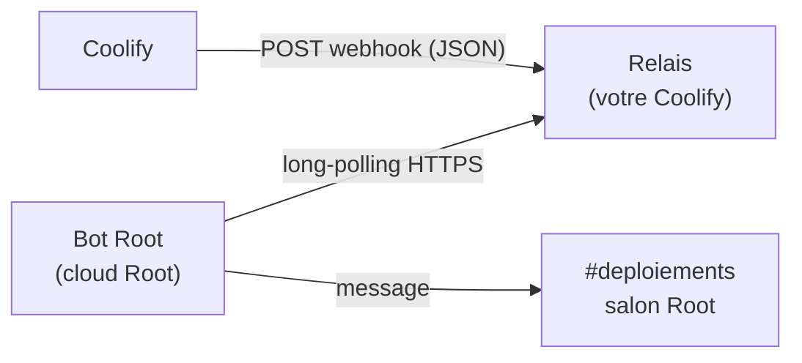

<div align="center">

# Notifications Coolify pour Root

**Recevez vos déploiements, sauvegardes et alertes serveur [Coolify](https://coolify.io) dans vos salons [Root](https://rootapp.com), comme avec l'intégration Discord.**

[](https://github.com/RonflexAzOg/root-coolify-notifier/actions/workflows/ci.yml)
[](LICENSE)

[English](README.md) · Français

</div>

```
❌ Échec du déploiement · api
Projet : shop / production
🔗 Ouvrir dans Coolify
```

## Pourquoi un relais ?

Les bots Root tournent dans le cloud de Root et **ne peuvent pas recevoir de webhooks**. Coolify, lui, ne sait qu'**envoyer** des webhooks. Ce projet fait le pont avec un petit relais que vous déployez en un clic sur votre propre Coolify :



- **Temps réel** : le bot fait du long-polling, les notifications arrivent en moins d'une seconde.
- **Fiable** : les événements restent en file sur le relais jusqu'à ce que le bot confirme leur publication. Coolify réessaie si le relais est indisponible.
- **Sécurisé** : l'URL du webhook ne contient qu'une empreinte du secret du bot. La connaître permet d'envoyer des événements, jamais de les lire.
- **Zéro dépendance** : le relais tient en ~500 lignes de TypeScript, sur le serveur HTTP et le SQLite intégrés à Node.

## Démarrage rapide

Prérequis : une instance Coolify (v4) et une communauté Root dans laquelle vous pouvez gérer les apps.

### 1. Déployer le relais sur Coolify (2 min)

Dans Coolify : **New Resource → Public Repository** → `https://github.com/RonflexAzOg/root-coolify-notifier`

| Paramètre | Valeur |
|---|---|
| Build pack | Dockerfile |
| Base directory | `/relay` |
| Port | `8080` |
| Domaine | n'importe quel domaine HTTPS public (celui généré en `sslip.io` convient) |
| Stockage persistant | un volume monté sur `/data` |
| Variables d'environnement | `TRUST_PROXY=true` |

Ou utilisez **Docker Compose** avec [`relay/docker-compose.yml`](relay/docker-compose.yml), qui règle tout cela.

Vérification : `https://votre-domaine-relais/healthz` renvoie `{"status":"ok"}`.

> Coolify refuse les URLs de webhook sur un réseau privé : utilisez le domaine public, pas un nom d'hôte Docker interne.

### 2. Ajouter le bot à votre communauté Root

Installez **Coolify Notifications** depuis le store Root. Pendant l'installation, choisissez les **Bot admins** : les rôles ou membres autorisés à le configurer.

### 3. Connecter un salon

Dans le salon Root qui doit recevoir les notifications :

```
/coolify setup https://votre-domaine-relais
/coolify lang fr
```

Le bot répond avec une URL de webhook. Dans Coolify, ouvrez **Notifications → Webhook**, collez-la, activez-la, choisissez vos événements, enregistrez, puis cliquez sur **Send Test Notification**. C'est prêt. 🎉

> Conseil : lancez `/coolify setup` dans un salon privé. Toute personne qui voit l'URL du webhook pourrait publier de fausses notifications (`/coolify rotate` en génère une nouvelle).

## Commandes

| Commande | Qui | Effet |
|---|---|---|
| `/coolify help` | tout le monde | Liste des commandes |
| `/coolify setup <url-relais> [clé-relais]` | admins du bot | Connecte le salon et donne l'URL du webhook |
| `/coolify status` | admins du bot | Relais, URL du webhook, état de la connexion, dernière notification |
| `/coolify test` | admins du bot | Publie une notification d'exemple |
| `/coolify lang <en\|fr>` | admins du bot | Langue des notifications dans ce salon |
| `/coolify rotate` | admins du bot | Nouvelle URL de webhook, l'ancienne cesse de fonctionner |
| `/coolify remove` | admins du bot | Déconnecte le salon |

Plusieurs salons peuvent être connectés, chacun avec son webhook : par exemple un par équipe Coolify, ou les échecs dans `#alertes` et tout le reste dans `#deploiements` (le choix des événements se fait par webhook dans Coolify).

## Événements pris en charge

Tous les événements webhook de Coolify sont pris en charge, avec une mise en forme dédiée pour : déploiements (réussite, échec, previews de PR), application arrêtée, limite de redémarrages, conteneur arrêté ou redémarré, sauvegardes de bases et de stockage (réussite, échec, alerte S3, manquante), tâches planifiées, nettoyage Docker, serveur joignable ou injoignable, disque plein, mises à jour système, Traefik obsolète, renouvellement SSL, expiration de token API. Les événements ajoutés par les futures versions de Coolify s'affichent avec leur message générique.

## Configuration du relais

Toutes les variables d'environnement sont optionnelles. Le tableau complet se trouve dans le [README anglais](README.md#relay-configuration). Les plus utiles :

- `TRUST_PROXY=true` derrière Coolify/Traefik ;
- `RELAY_ACCESS_KEY` (16 caractères min.) pour rendre le relais privé. Les bots passent alors la clé : `/coolify setup <url> <clé>` ;
- `DATA_DIR` : pensez à monter un volume persistant.

Un seul relais peut servir autant de communautés et de salons que nécessaire.

## Modèle de sécurité

- Le bot génère un secret aléatoire de 256 bits par salon, conservé dans le stockage de Root.
- L'URL du webhook contient `sha256(secret)`. Coolify peut **publier** avec, seul le bot, qui détient le secret, peut **lire**.
- Le relais n'accepte que les webhooks enregistrés par un bot, conserve au plus `MAX_EVENTS_PER_HOOK` événements pendant `EVENT_TTL_HOURS`, et les supprime dès leur publication.
- Le relais ne journalise jamais les contenus ni les secrets.
- Les commandes qui modifient ou révèlent la configuration sont réservées aux admins du bot choisis dans Root.

Signalez les vulnérabilités en privé : voir [SECURITY.md](SECURITY.md).

## Contribuer

Les contributions sont bienvenues, voir [CONTRIBUTING.md](CONTRIBUTING.md). La documentation technique est dans [`docs/`](docs/).

## Licence

[MIT](LICENSE). Projet indépendant, non affilié à Coolify ni à Root.
