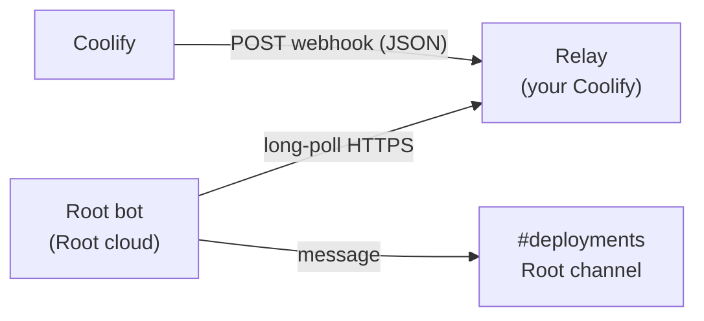

<div align="center">

# Coolify notifications for Root

**Get your [Coolify](https://coolify.io) deployments, backups and server alerts in your [Root](https://rootapp.com) channels, just like the Discord integration.**

[](https://github.com/RonflexAzOg/root-coolify-notifier/actions/workflows/ci.yml)
[](LICENSE)

English · [Français](README.fr.md)

</div>

```
❌ Deployment failed · api
Project: shop / production
🔗 Open in Coolify
```

## Why a relay?

Root bots run in Root's cloud and **cannot receive webhooks**. Coolify can only **send** webhooks. This project bridges the two with a tiny relay you deploy on your own Coolify in one click:



- **Real-time**: the bot long-polls, so notifications show up within a second.
- **Reliable**: events are queued on the relay until the bot confirms delivery. Coolify retries if the relay is down.
- **Secure by design**: the webhook URL only contains a hash of the bot's secret. Knowing it lets you send events, never read them.
- **Zero dependencies**: the relay is ~500 lines of TypeScript on Node's built-in HTTP server and SQLite.

## Quick start

You need: a Coolify instance (v4) and a Root community where you can manage apps.

### 1. Deploy the relay on Coolify (2 min)

In Coolify: **New Resource → Public Repository** → `https://github.com/RonflexAzOg/root-coolify-notifier`

| Setting | Value |
|---|---|
| Build pack | Dockerfile |
| Base directory | `/relay` |
| Port | `8080` |
| Domain | any public HTTPS domain (the generated `sslip.io` one works) |
| Persistent storage | mount a volume on `/data` |
| Environment | `TRUST_PROXY=true` |

Or use **Docker Compose** with [`relay/docker-compose.yml`](relay/docker-compose.yml), which sets all of the above.

Check it works: `https://your-relay-domain/healthz` returns `{"status":"ok"}`.

> Coolify refuses webhook URLs on private networks, so use the public domain, not an internal Docker hostname.

### 2. Add the bot to your Root community

Install **Coolify Notifications** from the Root store. During installation, choose the **Bot admins**: the roles or members allowed to configure it.

### 3. Connect a channel

In the Root channel that should receive notifications:

```
/coolify setup https://your-relay-domain
```

The bot replies with a webhook URL. In Coolify, open **Notifications → Webhook**, paste it, enable it, select your events, save, then click **Send Test Notification**. Done. 🎉

> Tip: run `/coolify setup` in a private channel. Anyone who sees the webhook URL could post fake notifications (`/coolify rotate` issues a new one).

## Commands

| Command | Who | What it does |
|---|---|---|
| `/coolify help` | everyone | List commands |
| `/coolify setup <relay-url> [relay-key]` | bot admins | Connect this channel and get the webhook URL |
| `/coolify status` | bot admins | Relay, webhook URL, connection health, last notification |
| `/coolify test` | bot admins | Post a sample notification |
| `/coolify lang <en\|fr>` | bot admins | Language of notifications in this channel |
| `/coolify rotate` | bot admins | New webhook URL, the old one stops working |
| `/coolify remove` | bot admins | Disconnect this channel |

Several channels can be connected, each with its own webhook: for example one per Coolify team, or failures in `#alerts` and everything in `#deployments` (event selection is done per webhook in Coolify).

## Supported events

Every Coolify webhook event is supported, with a dedicated layout for: deployments (success, failure, PR previews), application stopped, restart limit, container stopped/restarted, database and storage backups (success, failure, S3 warning, missing), scheduled tasks, Docker cleanup, server reachable/unreachable, high disk usage, OS updates, Traefik outdated, SSL renewal, API token expiry. Events added by future Coolify versions are shown with their generic message.

## Relay configuration

All settings are optional environment variables.

| Variable | Default | Description |
|---|---|---|
| `PORT` | `8080` | HTTP port |
| `DATA_DIR` | `./data` (`/data` in Docker) | SQLite location, **mount a volume** |
| `TRUST_PROXY` | `false` | Use `X-Forwarded-For` for rate limiting. Set `true` behind Coolify/Traefik |
| `RELAY_ACCESS_KEY` | _(empty)_ | Make the relay private: bots must pass it in `/coolify setup <url> <key>`. Min. 16 chars |
| `EVENT_TTL_HOURS` | `72` | Undelivered events are dropped after this |
| `HOOK_TTL_DAYS` | `30` | Hooks no bot has polled for this long are deleted |
| `MAX_EVENTS_PER_HOOK` | `500` | Queue size per webhook (oldest dropped) |
| `MAX_HOOKS` | `10000` | Max webhooks on this relay |
| `INGEST_PER_MINUTE` | `120` | Webhooks accepted per hook per minute (Coolify retries on 429) |
| `POLL_PER_MINUTE` | `120` | Poll requests per IP per minute |
| `MAX_WAIT_SECONDS` | `25` | Long-poll duration |
| `MAX_BODY_BYTES` | `65536` | Max webhook size |

One relay can serve any number of communities and channels. If you run a public relay for others, consider `RELAY_ACCESS_KEY` or keep the default limits.

## Security model

- The bot generates a random 256-bit secret per channel and keeps it in Root's storage.
- The webhook URL contains `sha256(secret)`. Coolify can **post** with it; only the bot, holding the secret, can **read**.
- The relay only accepts events for webhooks a bot has registered, stores at most `MAX_EVENTS_PER_HOOK` events for `EVENT_TTL_HOURS`, and deletes them as soon as they are delivered.
- The relay never logs payloads or secrets.
- Bot commands that change or reveal configuration are restricted to the bot admins chosen in Root.

Report vulnerabilities privately: see [SECURITY.md](SECURITY.md).

## Documentation

- [Architecture and relay protocol](docs/architecture.md): build your own client, or port the bot to another platform
- [Publishing the bot on Root](docs/publishing.md): for maintainers and forks
- [Contributing](CONTRIBUTING.md)

## Development

```bash
# Relay (Node ≥ 22.18, no build step)
cd relay && npm install && npm test && npm run dev

# Bot (needs a DEV_TOKEN from https://dev.rootapp.com in bot/.env)
cd bot && npm install && npm test && npm run bot
```

## License

[MIT](LICENSE). Not affiliated with Coolify or Root.
